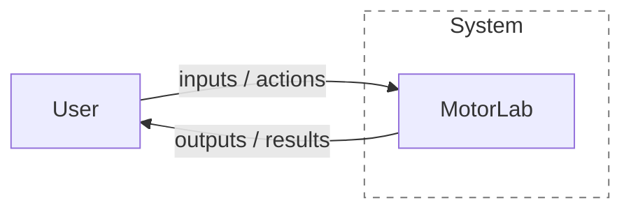

# Context and Scope

## Business Context

**\<Diagram or Table\>**

**\<optionally: Explanation of external domain interfaces\>**

## Technical Context

**\<Diagram or Table\>**

**\<optionally: Explanation of technical interfaces\>**

**\<Mapping Input/Output to Channels\>**
