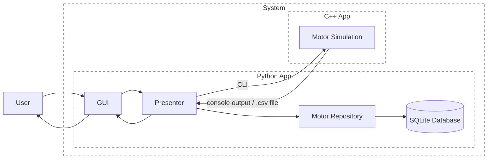
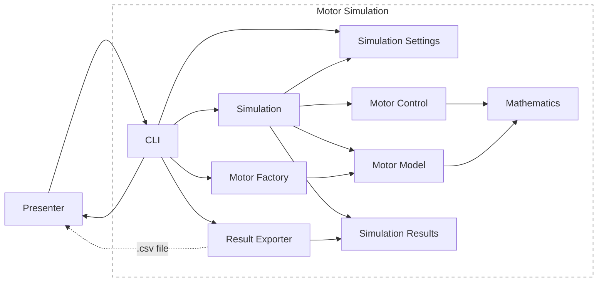
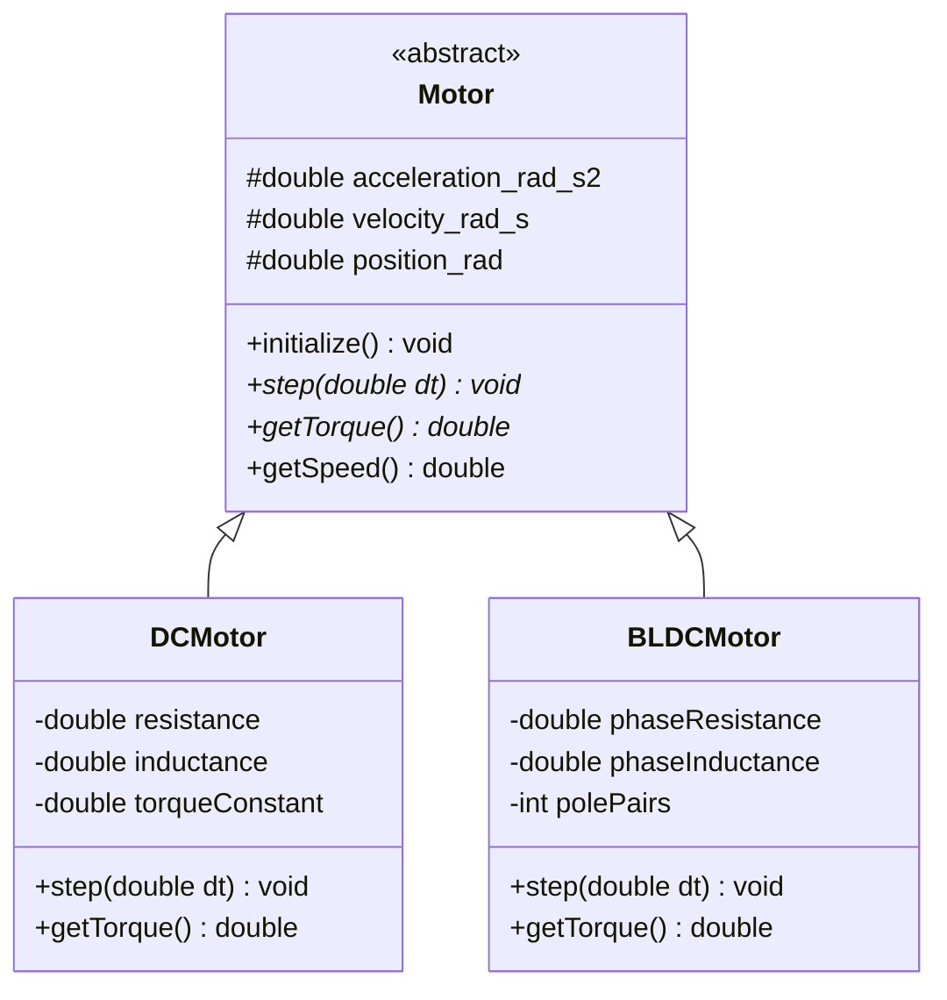

# Building Block View

## Whitebox Overall System

**Motivation**

**Contained Building Blocks**

| Name | Responsibility |
| --- | --- |
| GUI | Collect user input and display simulation settings and results. |
| Presenter | Coordinate GUI interactions, motor parameter access, simulation execution, and result preparation. |
| Motor Repository | Provide access to stored motor parameters and encapsulate database operations. |
| SQLite Database | Persist motor parameters locally. |
| Motor Simulation | Execute motor simulations with control algorithms and provide results through console output and CSV files. |

**Important Interfaces**

| Name | Responsibility |
| --- | --- |
| GUI–User | Allow the user to configure simulations, manage motor parameters, and view simulation results. |
| Motor Simulation CLI | Accept simulation configuration as JSON and start simulation execution. |
| Motor Simulation Console Output | Provide execution status and diagnostic messages monitored by the presenter. |
| Motor Simulation Result Export | Transfer simulation results from the C++ application to the Python application as CSV files. |

## Level 2

### Whitebox Motor Simulation

## Level 3

### Whitebox Motor Model

